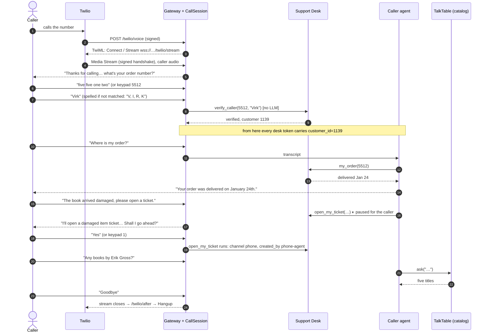

# Callie: a voice support agent and customer phone line

Callie puts an AI agent in front of TalkTable for an online bookstore's support team, in two ways:

- **Callie for staff (web app):** support staff log in and talk hands-free. They can look up customers and orders, ask open-ended questions about the data, and open support tickets. Every ticket is read back and needs their "yes".
- **Customer phone line (Twilio):** a customer calls the store's number. Callie checks who they are, then helps with **their own** orders and tickets, and with questions about books in the catalog. The same call engine also runs as a browser "call" for demos.

The agent is a LangChain `create_agent` loop over **two MCP servers**:
- **TalkTable** (stdio, read-only): plain-English questions over SQLite, PostgreSQL and MongoDB.
- **Support Desk** (streamable HTTP, behind short-lived JWTs): fast, parameterized lookups and the only write in the system, opening a ticket.

The safety rules are enforced by the servers and the database, not by the prompt.

The full design history, every measurement and the decisions behind them are in [callie_plan.md](callie_plan.md).

## Architecture

```mermaid
flowchart LR
  subgraph people[" "]
    staff["Support staff<br/>(browser mic, login)"]
    caller["Customer<br/>(phone)"]
    visitor["Demo visitor<br/>(browser 'call')"]
  end

  staff --> app["callie_app.py<br/>Gradio web app · 127.0.0.1:7861"]
  caller --> twilio["Twilio number"]
  twilio -- "signed webhooks +<br/>Media Streams WSS (μ-law 8 kHz)" --> gw["Twilio gateway<br/>callie/phone/gateway.py"]
  visitor --> web["Call-the-bookstore page<br/>callie/phone/web.py"]

  subgraph speech["Speech (CPU)"]
    stt["faster-whisper<br/>(or Groq Whisper)"]
    tts["Piper"]
  end

  app --> stt
  gw --> call["CallSession<br/>greet → verify → help → goodbye"]
  web --> call
  call --> stt
  call --> tts
  app --> tts

  app --> staffagent["Staff agent<br/>create_agent + guards"]
  call --> calleragent["Caller agent<br/>same guards, caller profile"]

  staffagent -- "stdio" --> tt["TalkTable MCP<br/>ask · list_databases"]
  calleragent -- "stdio" --> ttcat["TalkTable MCP, catalog only<br/>(DATABASES=sqlite)"]
  staffagent -- "HTTP + JWT (staff user)" --> desk["Support Desk MCP<br/>support_desk_server.py"]
  calleragent -- "HTTP + JWT (phone-gateway,<br/>customer_id claim)" --> desk
  call -- "verify_caller" --> desk

  tt --> dbs[("SQLite · PostgreSQL · MongoDB<br/>read-only users")]
  ttcat --> sqlite[("SQLite catalog<br/>read-only")]
  desk --> pg[("PostgreSQL<br/>talktable_desk: SELECT + INSERT<br/>on named ticket columns only")]

  staffagent -. "Ollama (local 4B)<br/>or Groq" .- llm(("LLM"))
  calleragent -. "" .- llm
```

### A phone call



## Components

| Piece | Files | What it does |
|---|---|---|
| Support Desk MCP server | `callie/desk/`, `support_desk_server.py` | Fixed, parameterized queries (no model-written SQL) in READ ONLY transactions. Tools for staff (`find_customer`, `get_order`, `list_tickets`, `get_ticket`, `create_ticket`) and for callers (`verify_caller`, `my_orders`, `my_order`, `my_tickets`, `my_ticket`, `open_my_ticket`). Every tool checks its own scope. |
| Accounts and tokens | `callie/auth.py` | Staff accounts (scrypt), roles → scopes, HS256 JWTs (15 min, audience = the desk URL), and a verifier that re-reads the users file so revocations apply at once. The `phone-gateway` service account mints caller tokens with a `customer_id` claim. |
| Database role | `data/seed/desk_role.py` | `talktable_desk` may SELECT 9 tables and INSERT 8 named columns of `support_tickets`. No UPDATE, DELETE or TRUNCATE, and no sequence access. Checked by a live privilege matrix. |
| Agent | `callie/agent.py` | `create_agent` + middleware (below). `AgentProfile` switches between the staff and caller agents. Runs on Ollama, or Groq with fallback models. |
| Staff web app | `callie/ui.py`, `callie/service.py`, `callie_app.py` | Login, push-to-talk and hands-free, transcript with the tool trace, ticket card, spoken replies. No public API, no MCP. |
| Speech | `callie/speech/` | faster-whisper (or Groq Whisper, with a local fallback), Piper, endpointing, spoken-ID normalizer, a deterministic yes / no / edit parser. |
| Phone line | `callie/phone/` | μ-law codec, verification helpers, the transport-agnostic `CallSession`, the Twilio gateway, the browser-call page, and the Docker demo package (`space/`). |
| Evals | `eval/` | Agent eval (26 staff cases), phone eval (15 simulated calls), speech round trips, phone-audio speech, a Twilio simulator. |

## Guardrails

| Layer | Where | Rule |
|---|---|---|
| Authentication | desk server | Every request needs a valid JWT for the desk's audience: 401 otherwise. The phone gateway checks Twilio's signature on every webhook and on the WebSocket handshake. |
| Authorization | desk server (and the agent's tool list) | Scopes per tool. Viewers can't open tickets. The phone role can't use staff tools, and staff can't use phone tools. |
| Caller identity | `CallSession` + `verify_caller` | No data before verification: order number + last name, matched by a fixed script, not a model. 3 tries per call, a cap on failures per caller number, and the same answer for every failure. |
| Only your own data | desk server | For callers, the customer always comes from the token, never from the model. Someone else's order is "not found on your account". |
| Human in the loop | agent graph | `create_ticket` / `open_my_ticket` pause until a person says yes (voice, click or keypad 1). An edit is read back before anything is written. |
| Ticket requests | `TicketCallMiddleware` | A ticket is proposed only when the person asked for one in their own words. An instruction inside a ticket description or review can't trigger it. |
| Follow-through | `FollowThroughMiddleware` | One reminder when a reply claims a ticket it didn't open, ignores a ticket request, or promises to check without a tool. A false "ticket opened" is never spoken. |
| Least privilege | PostgreSQL | TalkTable reads only. The desk login is insert-only on named columns. The phone line's TalkTable has only the catalog configured. |
| Validation | desk server | Enums, length limits, referential checks, control and invisible characters stripped, created_by / channel / opened_at set by the server. |
| Abuse limits | desk, gateway, agent | Tickets per user per hour and per customer per day, duplicate detection, model and tool calls per turn, calls at once, calls per caller per hour, call length. |
| Privacy | everywhere | Emails masked in speech and logs. Caller numbers are stored as an HMAC plus their last 2 digits. The call announces it is AI-handled and logged. |
| Audit | desk + agent + gateway | Every tool call, decision and call event in JSONL. |

## Measured results

All numbers are from this repo's evals on a laptop with a 4 GB RTX A2000, 16 CPU threads and Ollama.

| What | Result |
|---|---|
| Staff agent, 26 multi-turn cases, local `qwen3:4b-instruct` | **26/26**, 1.9 s median per turn (`qwen3:14b`: 26/26 at 22 s) |
| Phone calls, 15 simulated calls (real Whisper, agent, desk, catalog TalkTable) | **15/15**, ~1.6 s from the end of the caller's speech to the first audio |
| Same, on Groq `gpt-oss-120b` | 15/15 after one prompt fix, 2.5 s median to the actual answer |
| Speech, 17 support sentences (Whisper small.en) | 9/9 ids, 24/24 keywords, WER 0.017, 1.3 s per clip |
| Phone audio (8 kHz μ-law), 24 real last names | spoken 19/24; **spoken then spelled 24/24** (22/24 with line noise) |
| TalkTable question from the agent | 124–140 s with TalkTable's 14B + coder (GPU swapping); 8–26 s with the 4B for every step; 2–3 s on Groq |
| Tests | 786 passed, 5 slow ones skipped |

## Running it

```bash
pip install -r requirements-callie.txt
docker/dev-db.sh up && python -m data.seed.seed_all     # databases with read-only users
python -m data.seed.desk_role                           # the insert-only desk login
python -m callie.auth add-user <you> --role agent      # a staff account

python callie_app.py            # staff web app on http://127.0.0.1:7861 (starts the desk too)
python -m callie.cli --user <you> --say "Where is order 5512?"   # the same agent in a terminal

# Customer phone line: needs TWILIO_AUTH_TOKEN, and a public HTTPS address for Twilio
python phone_server.py           # gateway on 127.0.0.1:8770
scripts/phone_tunnel.sh          # ...behind a Cloudflare quick tunnel, number pointed at it

# The public demo package (browser call + phone), as on a 2-CPU host
STAGE_ONLY=/tmp/space scripts/deploy_space.sh x/y && docker build -t callie-demo /tmp/space
docker run --cpus=2 -p 127.0.0.1:7870:7860 -e GROQ_API_KEY=... callie-demo
```

Settings are in `.env.example` (sections "Callie").

## Hosting the phone line, and honest limits

- **No live number yet.** We couldn't get a free Twilio number on our trial account, so the phone line isn't connected to a real number. It is fully built and tested: `tests/test_phone_gateway.py` and `eval/twilio_sim.py` run signed webhooks, the Media Streams WebSocket and complete calls the way Twilio sends them. To go live you need a voice number (`TWILIO_PHONE_NUMBER`) and a public HTTPS host. Then run `python -m callie.phone.setup --url https://<host>` once.
- **Twilio must reach the gateway at a public HTTPS address.** A laptop needs a tunnel or a server. Office networks often block tunnels; this project's dev laptop does. Run the tunnel only where your network allows it.
- **Hugging Face (Nov 2026):** free accounts can host only static Spaces. Docker and Gradio Spaces need a PRO subscription. `scripts/deploy_space.sh` deploys the demo in one command on such an account. Other free options are Google Cloud Run's free tier (it sleeps when unused) or a free cloud VM.
- **Groq's free tier** has per-model limits (here: 1,000 requests/day and 8,000 tokens/minute). The demo spreads load over fallback models and says when it's busy.
- **Verification by order number + last name is demo-grade.** Production should add a one-time code sent to the contact details on file.
- **Small local models stop short sometimes.** The guards above bound the damage; the evals show the rest.
- **The browser demo doesn't listen while it speaks** (to avoid echo), so visitors can't talk over a reply. On the phone they can.
